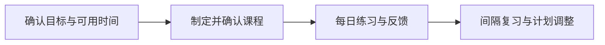

# LearningLoop

把长期学习目标拆成每日任务，并把练习反馈接回复习计划。LearningLoop 围绕目标确认、课程规划、每日辅导和 FSRS 间隔复习保存学习状态，中断后可以继续。

[本地启动](#本地启动) · [系统架构](docs/architecture.md) · [定时提醒](docs/notifications.md) · [运行命令](docs/operations.md)

## 主要功能

| 功能 | 做什么 |
| --- | --- |
| 目标与课程计划 | 结合基础、目标、学习周期和可用时间生成课程，确认后采用 |
| 每日学习 | 按日期查看任务，展开概念、示例和练习，提交答案、笔记与评分 |
| 复习与调整 | 根据练习结果更新掌握情况、错题和 FSRS 复习卡，支持延期后的计划恢复 |
| 用量查看 | 按会话与模型查看 Token、耗时和费用估算，支持 CSV / JSON 导出 |
| 定时提醒 | 发送今日计划与晚间复盘，可在页面设置邮箱、时区和时间 |

## 学习流程



对话与定时任务共用学习 Runtime。五类 Skill 分别处理目标确认、课程规划、每日辅导、复习和计划恢复；类型化工具读写学习状态，替换计划等操作需要确认。

SQLite 保存会话、事件、审批和模型调用记录，JSON 工作区保存课程、掌握情况、错题与复习卡。Checkpoint 与工具执行记录支持中断恢复，并避免恢复时重复执行已完成的操作。

## 本地启动

需要 Python 3.12；以下使用 Conda：

```powershell
git clone https://github.com/xbzz1018/learningloop.git
cd learningloop
conda env create -f environment.yml
conda activate learningloop
python -m pip install -r requirements.lock
python -m pip install -e . --no-deps
Copy-Item .env.example .env
```

编辑 `.env`。默认使用官方 DeepSeek，只需填写 `LEARNINGLOOP_DEEPSEEK_API_KEY`；Flash 处理日常辅导，Pro 用于复杂规划。

| 参数 | 默认值 / 用途 |
| --- | --- |
| `LEARNINGLOOP_DEEPSEEK_API_KEY` | 官方服务 Key |
| `LEARNINGLOOP_DEEPSEEK_BASE_URL` | `https://api.deepseek.com` |
| `LEARNINGLOOP_DEEPSEEK_FLASH_MODEL` | `deepseek-v4-flash` |
| `LEARNINGLOOP_DEEPSEEK_PRO_MODEL` | `deepseek-v4-pro` |
| `LEARNINGLOOP_DATA_DIR` | `./data`，学习状态与运行记录目录 |
| `LEARNINGLOOP_PORT` | `8765`，本机服务端口 |

```powershell
learningloop doctor
learningloop serve
```

打开 <http://127.0.0.1:8765/>。`doctor` 检查当前配置，不调用模型；真实模型兼容性检查使用 `learningloop doctor --live`。

## 第一次学习

1. 新建学习会话，说明目标，例如“我有 Python 基础，希望用四周学习 SQL，每天半小时”。
2. 补充当前基础、目标成果与时间安排，确认课程计划。
3. 在「今日计划」展开任务，学习示例、完成练习并记录答案与评分。
4. 在「复习中心」处理到期卡片，在「课程进度」查看掌握情况并继续下一阶段。

需要邮件时，在 `.env` 配置 SMTP，再到「通知设置」保存邮箱并启用提醒。默认每天 08:30 发送计划、20:30 发送复盘，时区为 `Asia/Shanghai`；服务运行期间执行调度。配置方法见[定时提醒](docs/notifications.md)。

## 常用命令与实现

| 内容 | 入口 |
| --- | --- |
| 课程、任务与复习状态 | [learning](src/learningloop/learning/) |
| Agent 运行与模型策略 | [Runtime](src/learningloop/agent/runtime.py)、[Policy](src/learningloop/agent/policy.py) |
| Web 页面与 API | [Web](src/learningloop/web/)、[接口说明](docs/api.md) |
| 备份与恢复 | [运行命令](docs/operations.md)、[恢复说明](docs/recovery.md) |
| Docker 与私有账号 | [本机 Compose](docker-compose.yml)、[部署说明](docs/deployment-tencent-cloud.md) |

运行离线测试：

```powershell
python -m pip install -r requirements.dev.lock
python -m pytest -q
```

技术栈：Python、FastAPI、Agent Harness、Pydantic、SQLite、FSRS。
